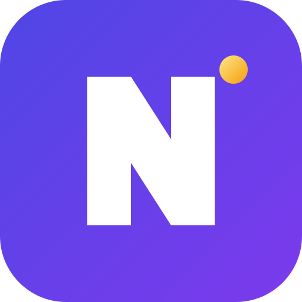

<p align="center">
  
</p>

<h1 align="center">Nudge</h1>

<p align="center">
  <strong>에이전트를 파싱하지 마세요. 넛지(Nudge)하세요.</strong><br>
  AI 에이전트를 위한 타입 안전(typed), 리플레이 가능(replayable), 예산 인식(budget-aware) 프로그래밍 언어.<br>
  네이티브 Bytecode 런타임 및 독립형 컴파일러. Python 및 TypeScript로 컴파일 가능.
</p>

<p align="center">
  
  
  
  
  <a href="https://marketplace.visualstudio.com/items?itemName=Nekomya.nudge-lang"></a>
  <a href="https://snyk.io"></a>
</p>

---

<p align="center">
  <a href="README.md">English</a> •
  <a href="README.zh-CN.md">中文</a> •
  <a href="README.ja-JP.md">日本語</a> •
  <a href="README.ko-KR.md">한국어</a> •
  <a href="README.ru-RU.md">Русский</a> •
  <a href="README.tr-TR.md">Türkçe</a>
</p>

---

## 왜 Nudge인가?

프로덕션 환경의 에이전트는 여전히 글루 코드(glue code)로 간신히 유지되고 있습니다. 수작업으로 파싱되는 프롬프트 체인, try/except 블록으로 감싼 툴 호출, 결여된 리플레이 기능, 예측 불가능한 비용, 그리고 전무한 회귀 테스트. 라이브러리는 문제가 발생한 후에야 증상을 땜질합니다. **Nudge는 문제가 실제로 존재하는 계층, 즉 언어 자체를 바로잡습니다.**

| 문제점 | 기존 라이브러리 | Nudge |
|:---|:---|:---|
| 타입 없는 LLM 출력 | 런타임에 검증 | Schema는 일급 언어 타입이며 컴파일 타임에 검증됨 |
| 숨겨진 사이드 이펙트 | 보이지 않음 | 시그니처에 명시적으로 선언된 10가지 타입화된 Effect (`uses LLM, Tool, IO, ...`) |
| 회귀 테스트 부재 | 레코드와 리플레이를 사후 추가 | 모든 실행은 NTF trace를 생성하며, 모든 trace는 결정론적인 $0 테스트 |
| 예기치 않은 비용 | 청구서가 도착한 후 모니터링 | Budget은 컴파일러와 런타임이 강제하는 엄격한 계약 |
| 동시성 스파게티 | 수동 비동기 루프 | 컴파일 타임 레이스 안전성을 갖춘 네이티브 `par map / race / all` |

## Nudge 미리보기

```nudge
type Finding = { claim: string, source: Url, confidence: float @range(0, 1) }

fn analyze(q: string, hits: [SearchResult]) -> [Finding] uses LLM {
    llm"""Extract verifiable findings about {q} from: {hits}"""
    with { schema: [Finding], model: "anthropic:sonnet-4.6",
           budget: 0.03 USD, retry: 2 with repair }
}

test "stays within budget on recorded trace" {
    let t = replay("traces/demo.jsonl")
    assert t.cost_usd < 0.25          // zero tokens burned in CI
}
```

컴파일러는 스키마 일치를 증명하고, Effect를 추론하며, 최악의 경우의 비용을 제한합니다. 런타임은 모든 호출을 콘텐츠 주소 지정 trace에 기록하므로 diff 비교, 커밋, 그리고 $0 리플레이가 가능합니다.

## 빠른 시작

### 1. Nudge 설치

**원라인 인스톨러 (권장):**

```sh
# Linux / macOS
curl -fsSL https://raw.githubusercontent.com/NekomyaDev/nudge/main/install.sh | bash

# Windows (PowerShell 관리자 권한으로 실행)
irm https://raw.githubusercontent.com/NekomyaDev/nudge/main/install.ps1 | iex
```

**패키지 매니저 및 컨테이너:**

```sh
# Snap (Linux)
sudo snap install nudge --classic

# Docker
docker run -it --rm -v $(pwd):/workspace nekomyadev/nudge nudgec --help
```

Linux, macOS, Windows용 사전 빌드된 바이너리 또한 [Releases](https://github.com/NekomyaDev/nudge/releases) 페이지에서 다운로드할 수 있습니다.

### 2. 60초 첫 실행 (네이티브, $0)

Python, Node.js, API 키가 전혀 필요하지 않습니다. Nudge에는 네이티브 스택 VM과 인메모리 결정론적 fake 프로바이더가 기본 내장되어 있습니다:

```sh
# 프로그램 생성
cat > hello.ndg << 'EOF'
type Greeting = { message: string, timestamp: string }

fn greet(name: string) -> Greeting uses LLM {
    llm"""Create a greeting for {name}. Return message and timestamp."""
    with { schema: Greeting, model: "anthropic:sonnet-4.6", budget: 0.01 USD }
}

fn main() -> Greeting uses LLM {
    greet("World")
}
EOF

# 프로그램 타입 검사
nudgec check hello.ndg

# 네이티브 Bytecode VM에서 직접 실행 ($0, 키 불필요)
nudgec run hello.ndg

# 오프라인 회귀 테스트 실행
nudgec test hello.ndg
```

### 3. 인터랙티브 레슨 및 프로젝트 생성

```sh
# 터미널에서 동작하는 6가지 대화형 레슨 (hello, types, decide, policy, test, trace)
nudgec learn

# 준비된 템플릿으로 프로젝트 생성 (triage, chatbot, rag-agent 등)
nudgec init my-agent --template triage
cd my-agent && nudgec check my-agent.ndg && nudgec run my-agent.ndg
```

### 4. Python 또는 TypeScript로 컴파일 (선택 사항)

기존 Python 또는 TypeScript 서비스에 배포하는 경우:

```sh
# Python 타깃
pip install nudge-runtime          # standard library only, zero dependencies
nudgec build hello.ndg              # emits out/hello.py
python3 out/hello.py

# TypeScript 타깃
nudgec build-ts hello.ndg             # emits out/hello.ts
```

## 핵심 기능 한눈에 보기

| 기능 | 제공 내용 | 섹션 |
|:---|:---|:---|
| **타입화된 LLM 호출** | 출력 스키마가 언어 타입으로 동작하며, 위반 시 자동 복구 트리거 | [Nudge 미리보기](#nudge-미리보기) |
| **제어 흐름 및 데이터** | `if/else`, `for` 루프, 레코드 리터럴 `{k: v}`, 인덱싱, 가변 지역 변수 | [제어 흐름 및 데이터](#제어-흐름-및-데이터) |
| **타입화된 Effect** | 컴파일 타임에 추적 및 검사되는 10가지 기지 Effect | [타입화된 Effect](#타입화된-effect) |
| **워크스페이스 및 저장소** | 샌드박스화된 파일시스템 + 타입 안전 영구 Key-Value 저장소 | [격리된 워크스페이스 및 영구 저장소](#격리된-워크스페이스-및-영구-저장소) |
| **로컬 UI** | 타입화된 뷰, 윈도우, 헤드리스 테스트, 네이티브 OS 데스크톱 창 | [로컬 UI](#로컬-ui) |
| **태스크 및 동시성** | 태스크 spawn/join, 협력적 취소, 안전한 `par race`, 예산 즉시 반환 | [태스크 수명 주기 및 동시성](#태스크-수명-주기-및-동시성) |
| **프로바이더 인증** | Fail-Closed(안전 우선) RFC 8628 OAuth 디바이스 플로우, 외부 토큰 무단 수집 차단 | [프로바이더 인증](#프로바이더-인증) |
| **타입화된 의사결정** | 배치 분류, Yes/No 판별, 상태에 대한 루브릭 채점 (`/v1/systemone`) | [타입화된 의사결정](#타입화된-의사결정) |
| **컴퓨터 사용** | 화면 관찰, 타입화된 액션, 애플리케이션 허용 목록, 킬 스위치 | [컴퓨터 사용](#컴퓨터-사용) |
| **Bytecode VM** | 기본 스택 VM 엔진 (순수 연산 약 70배 가속, 깊은 재귀 안전성) | [Bytecode VM 엔진](#bytecode-vm-엔진) |
| **독립형 네이티브 에이전트** | Cargo 불필요 단일 바이너리 패키징 (라이브 약 2.09MB, 리플레이 전용 약 832KB) | [독립형 네이티브 에이전트 (Cargo 불필요)](#독립형-네이티브-에이전트-cargo-불필요) |
| **WebAssembly** | WASI 환경 오프라인 리플레이 (약 526KB), 라이브 툴 호스트 브리지 | [WebAssembly 타깃](#webassembly-타깃) |
| **결정론적 Trace** | 개방형 NTF v1 trace, $0 리플레이, CI 회귀 게이트, trace diff 비교 | [결정론적 Trace 및 에이전트 CI](#결정론적-trace-및-에이전트-ci) |
| **프라이버시 마스킹** | 단일 병목 지점 기반 시크릿/개인정보(PII) 기본 자동 마스킹 | [프라이버시 및 Trace 마스킹](#프라이버시-및-trace-마스킹) |

## 언어 명세 및 기능

### 제어 흐름 및 데이터

Nudge는 결정론적 안전 경계를 갖춘 친숙한 구조적 프로그래밍 구문을 제공합니다:

```nudge
fn process_scores(raw: [int]) -> { total: int, count: int } {
    let mut total = 0
    let mut count = 0

    for (score, idx) in raw {
        if score >= 50 {
            total = total + score
            count = count + 1
        } else {
            // skip failing scores
        }
    }

    { total: total, count: count }
}
```

- **조건 분기:** 다중 구문 블록을 지원하는 `if/else` 및 `else if` 표현식.
- **반복문:** 순차 `for item in coll` 루프 및 인덱스를 포함하는 `for (item, idx) in coll` 루프.
- **구조화된 데이터:** 정적 타입 및 필드 접근 (`obj.field`)을 지원하는 레코드 리터럴 `{ field1: expr1, field2: expr2 }`.
- **인덱싱:** 컬렉션 및 레코드에 대한 인덱스 기반 접근 (`items[0]`, `map["key"]`). 범위를 벗어난 오류는 `E0705`로 명확하게 실패합니다.
- **가변 지역 변수:** 명시적인 `let mut name = init` 변수 선언과 재할당 (`name = next`).
- **루프 한계선:** 루프는 무한 실행을 방지하기 위해 `NUDGE_MAX_LOOP_ITERATIONS`(기본값 10,000)으로 제한되며 초과 시 `E0703`을 발생시킵니다.

### 타입화된 Effect

모든 사이드 이펙트는 함수 시그니처에 선언되고 컴파일러에 의해 검증됩니다:

```nudge
fn run_pipeline() -> bool uses LLM, Tool, Workspace, Store {
    // Calling unlisted effects triggers compiler error E0301
}
```

Nudge는 10가지 기지 Effect를 정의합니다 (`crates/nudgec/src/check.rs`):
- `LLM`: 언어 모델 생성 또는 스트리밍 프롬프트 호출.
- `Tool`: 외부 MCP 툴 또는 등록된 툴 호출.
- `IO`: 호스트 입출력 연산 (`print`, `println`).
- `Decision`: `decide{}`를 통한 의사결정 모델 쿼리.
- `Computer`: `computer.*`를 통한 데스크톱 환경 및 접근성 트리 조작.
- `Workspace`: 샌드박스화된 워크스페이스 내부의 스코프 제한 읽기/쓰기 작업.
- `WorkspaceDelete`: 워크스페이스 내부의 파괴적인 파일 또는 디렉터리 삭제 작업.
- `Store`: `store.*`를 통한 영구 Key-Value 저장소 작업.
- `UI`: 그래픽 사용자 인터페이스 요소 생성, 마운트 또는 이벤트 디스패치.
- `Auth`: 인증된 프로바이더 리소스 접근 (스코프 제한 `Auth(account)` 지원).

`uses` 절이 없는 함수는 컴파일 타임에 순수 함수(pure function)임이 증명됩니다. 알 수 없는 Effect는 `E0302`로 거부됩니다.

### 격리된 워크스페이스 및 영구 저장소

로컬 에이전트는 시스템 보안을 해치지 않으면서 파일과 상호작용하고 실행 간에 상태를 유지해야 합니다:

```nudge
record Config {
    theme: string,
    max_entries: int
}

fn update_workspace_file(path: string, new_content: string) -> bool uses Workspace, Store {
    // 1. Scoped filesystem access (path traversal and symlink escapes denied)
    if workspace.exists(path) {
        workspace.write(path, new_content)   // Atomic write: staging, fsync, rename
    }

    // 2. Typed persistent store (survives process restarts and reboots)
    store.set("app_config", Config { theme: "dark", max_entries: 100 })
    true
}
```

- **샌드박스 워크스페이스 (`workspace.*`):** 모든 작업은 명시적인 워크스페이스 루트(`--workspace` 또는 `NUDGE_WORKSPACE_DIR`로 구성, 기본값은 현재 디렉터리)로 제한됩니다. 경로 탐색(`../`) 및 루트 외부로의 심볼릭 링크 이탈이 차단됩니다. 쓰기 작업은 크래시 일관성을 보장합니다(임시 파일 스테이징, fsync, 원자적 이름 변경).
- **삭제 권한 분리:** 파일이나 디렉터리를 삭제하려면 전용 `WorkspaceDelete` Effect(`uses WorkspaceDelete`)가 필수이며, 일반 쓰기 루틴이 실수로 디렉터리를 삭제하지 못하도록 방지합니다.
- **타입화된 영구 Key-Value 저장소 (`store.*`):** `<workspace>/.nudge/store.json`(또는 `NUDGE_STORE_PATH`)에 저장되는 강타입 스토리지입니다. 임시 실행 체크포인트와 달리 프로세스 재시작 및 시스템 재부팅 후에도 데이터가 보존됩니다.

### 프로세스 및 파일 감시

빌드/테스트 러너, 언어 서버, 라이브 리로드 툴을 구동하는 에이전트를 다른 모든 기능과 동일한 Effect 및 권한 규칙으로 구축할 수 있습니다:

```nudge
fn watch_and_rebuild() -> bool uses FsWatch, Process {
    // 1. Bounded, workspace-confined file watching (no indefinite hang)
    let changes = fs.watch("src", 5000)          // dir/path + timeout (ms)

    // 2. Controlled child process: program and args SEPARATELY (never a shell)
    let handle = proc.spawn("cargo", ["build", "--quiet"], 60000)
    let out = proc.await(handle)
    proc.alive(handle) == false
}
```

- **파일 감시 (`fs.watch`, `FsWatch` Effect):** 워크스페이스 경로의 변경 이벤트를 감시합니다. 타임아웃으로 한계가 지정되어 무한 대기하지 않으며 워크스페이스 루트 내로 엄격히 제한됩니다(탈출 거부). 미선언 사용은 컴파일 오류(`E0301`)로 차단됩니다.
- **통제된 자식 프로세스 (`proc.*`, `Process` Effect):** `proc.spawn(cmd, argv, timeout_ms)` / `proc.run(...)` (spawn + await) / `proc.await` / `proc.kill` / `proc.alive`. `cmd`와 `argv`는 **별도로** 전달되며 셸 없이 직접 실행되므로 셸 인젝션 공격 면이 없습니다. 수명 주기가 제한되며(`E0921`) 태스크 종료 또는 취소 시 자식 프로세스가 회수되어 **고아 프로세스가 발생하지 않습니다**. 프로세스 실행은 기본적으로 **Fail-Closed(차단)** 상태이며, `NUDGE_PROCESS_GRANTS`로 허용되지 않는 한 거부됩니다(`E0920`, 워크스페이스 격리 `E0922`).

### 로컬 UI

인간 피드백 루프(Human-in-the-loop) 인터페이스, 승인 스테이션, 인터랙티브 검사 패널을 Nudge 내에서 직접 구축할 수 있습니다:

```nudge
type ReviewState = { prompt: string, approved: bool }

view ReviewCard(state: ReviewState) -> View {
    column(padding = 16, gap = 12) [
        text("Agent Review Station", size = 18, bold = true),
        text("Request: " + state.prompt),
        row(gap = 8) [
            button("Approve", on_click = approve_action),
            button("Reject", on_click = reject_action)
        ]
    ]
}

agent ReviewStation {
    state {
        prompt: string = "Execute deploy script",
        approved: bool = false
    }

    fn approve_action() uses UI, IO {
        state.approved = true
        io.println("Action approved")
    }

    fn reject_action() uses UI {
        state.approved = false
    }

    window MainWindow {
        title: "Nudge Review Station",
        width: 500,
        height: 300,
        content: ReviewCard(state)
    }
}
```

- **이중 모드 실행:**
  - **헤드리스 테스트:** `mount_headless()` 및 `dispatch_click()`을 통해 물리적인 창을 띄우지 않고 메모리에서 UI 트리 및 상태 전이를 완벽하게 평가합니다. CI에서 $0로 실행됩니다.
  - **네이티브 데스크톱 GUI:** Cargo의 `native-gui` 기능으로 컴파일할 경우, `window.open()`은 `winit` 및 `softbuffer` 기반의 네이티브 OS 윈도우를 생성합니다.
- **헤드리스 폴백:** `NUDGE_UI_HEADLESS=1`을 설정하거나 trace 리플레이 중(`NUDGE_REPLAY`)에는 윈도우 호출이 자동으로 헤드리스 엔진으로 라우팅됩니다.

### 태스크 수명 주기 및 동시성

정형화된 태스크 상태 관리 및 협력적 취소 메커니즘을 통해 동시 에이전트 분기들을 조율합니다:

```nudge
fn race_models(prompt: string) -> string uses LLM {
    // par race automatically cancels losing branches
    par race {
        fast: query_fast_model(prompt),
        deep: query_deep_model(prompt)
    }
}
```

- **협력적 취소:** race 조건이 해결되면 탈락한 분기는 백그라운드에서 예산을 낭비하지 않고 루프, 스트림, Effect 경계에서 즉시 중단됩니다.
- **예산 보호:** `NUDGE_BUDGET` 하에서 예약된 미사용 예산은 태스크 취소 즉시 반환됩니다.
- **Fail-Closed 권한 회수:** 취소된 태스크는 추가적인 툴 호출(`Tool`) 또는 컴퓨터 작업(`Computer`)을 디스패치할 권한을 즉시 상실합니다.
- **태스크 프리미티브:** `task.spawn`, `task.join`, `task.status`, `task.cancel`을 통한 명시적 태스크 제어.

### 프로바이더 인증

언어와 런타임에 직접 내장된 안전한 자격 증명 관리:

- **Fail-Closed 인증:** 함수는 `uses Auth` 또는 `uses Auth(account)`를 통해 명시적인 인증 요구사항을 선언합니다. 미인증 호출은 안전 우선으로 차단됩니다.
- **외부 토큰 무단 수집 차단:** Nudge는 타사 툴의 비공개 토큰 캐시나 자격 증명 저장소를 절대 무단으로 읽지 않습니다.
- **네이티브 RFC 8628 디바이스 플로우:** OAuth 2.0 Device Authorization Grant를 통한 터미널 기반 대화형 인증 및 `~/.nudge/credentials.json`(파일 권한 0600) 내 안전한 저장.
- **프로바이더 게이트:** 프로바이더는 검증 가능한 보안 계약을 충족해야 합니다(자격 증명 누락 시 `E-auth-0401`, 스코프 부족 시 `E-auth-0403`, 비활성화된 프로바이더는 `E-auth-0404`).
- **미검증 프로바이더 차단 (권한 게이트):** 공식적인 서드파티 사용 권한이 증명되지 않은 프로바이더는 **기본적으로 Fail-Closed(비활성화)** 처리됩니다. 이는 현재 `antigravity`에 적용되어 있습니다. OAuth 로그인 플로우와 프로바이더 코드는 존재하지만 해당 OAuth 클라이언트와 모델 엔드포인트를 독립된 서드파티 클라이언트에서 사용할 수 있다는 공식 증거가 확인되지 않았으므로 권한이 검증될 때까지 게이트는 **비활성화 상태**(`E-auth-0404`)로 유지됩니다. **모의 OAuth 테스트나 CI 통과가 실제 계정 접근이나 사용 권한을 입증하지는 않습니다.** Nudge 기반 애플리케이션을 포함한 모든 사용자는 해당 권한이 문서화되기 전까지 이 연결에 의존해서는 안 됩니다. 권한 확인 후 명시적인 사용자 동의(`NUDGE_ENABLE_ANTIGRAVITY=1`)를 통해 사용자 본인의 책임 하에 활성화할 수 있습니다.

### 타입화된 의사결정

`/v1/systemone` 와이어 프로토콜을 통해 의사결정 모델(Laya, Jev 등)의 불확실성을 컴파일합니다:

```nudge
fn triage(t: string) -> string uses Decision {
    let d = decide {
        dept:    "which team handles this?" choose [billing, technical, security],
        churn:   "does the customer threaten to cancel?" yes/no,
        urgency: "how urgent is this?" score [low, soon, critical]
    }
    on t
    with { model: "laya:multilingual", deadline: 50 }   // ms latency budget
    route {
        auto: resolve(d.dept.winner) when d.dept.confidence > 0.8,
        review: escalate(d) otherwise
    }
}
```

- **배치 실행:** 단 한 번의 호출로 모든 질의를 동시에 평가하여 우승값, 확률, 분포, 신뢰도를 반환합니다.
- **비용 제로 테스트:** 기본 fake 의사결정 프로바이더가 결정론적 시드 기반 분포를 생성하여 $0 테스트를 지원합니다.
- **라이브 프로바이더:** `NUDGE_DECISION_SERVERS='{"laya": {"base_url": "http://localhost:8000"}}'`를 통해 로컬 또는 원격 모델에 연결할 수 있습니다.
- **의사결정 캐시:** `NUDGE_DECISION_CACHE=<path>`를 통해 검증된 응답을 실행 간에 캐싱하여 동일한 상태에 대해 중복 지출을 방지합니다.
- **정책 탐색:** `nudgec policy-sweep trace.jsonl --question dept --thresholds 0.5,0.8`을 실행하여 모델 호출 없이 기록된 분포 기반으로 임계값 조정을 평가할 수 있습니다. 자세한 내용은 [의사결정 문서](docs/decision.md)를 참조하세요.

### 컴퓨터 사용

언어가 제어와 안전을 책임지고 모델이 인식을 담당하는, 타입화된 관찰 및 액션 기반의 데스크톱 환경 제어:

```nudge
fn automate_app(app: string) -> bool uses Computer, Decision {
    let obs = computer.observe(app, allow = [app], deadline = 30000)
    let check = decide {
        ready: "is the target button visible?" yes/no
    } on obs.tree
    with { deadline: 100 }

    let r = route {
        click: computer.click(1, allow = [app]) when check.ready.p > 0.5,
        close: computer.key("Escape", allow = [app]) otherwise
    }
    r.ok
}
```

- **타입화된 프리미티브:** `computer.observe`는 `Observation` 레코드(접근성 트리, 요소 목록, 선택적 스크린샷)를 반환합니다. 액션(`click`, `type`, `key`, `scroll`, `set_value`, `drag`, `paste`)은 디스패치 영수증(`action_sent`)을 포함하는 `ActionResult`를 반환합니다.
- **리플레이 안전성:** trace 리플레이는 물리적인 액션을 절대 다시 트리거하지 않습니다. `NUDGE_COMPUTER_DRIFT=1`을 사용하면 런타임이 라이브 상태를 다시 관찰하고 실제 액션을 실행하지 않고 기계적 `Drift` diff를 계산합니다.
- **보안 강화:** 애플리케이션 허용 목록(`allow: [app]`), 컨트롤러 임대 잠금, 만료된 요소 인덱스 거부(`stale_state`), 강제 킬 스위치(`NUDGE_COMPUTER_KILL=1`).
- **결정론적 데스크톱:** 기본 fake 프로바이더가 인메모리 UI 시나리오(`NUDGE_COMPUTER_SCENARIO`)를 실행하여 $0 엔드투엔드 테스트를 가능하게 합니다. 자세한 내용은 [컴퓨터 사용 문서](docs/computer-use.md)를 참조하세요.

## 네이티브 인프라

### Bytecode VM 엔진

순수 함수, 데이터 변환, 라우트 분기는 전용 스택 기반 Bytecode VM(`crates/nudgec/src/bytecode.rs` 및 `vm.rs`)에서 실행됩니다:

- **초고속 순수 연산:** AST 트리 순회 인터프리터 대비 순수 코드를 약 70배 빠르게 실행합니다.
- **깊은 재귀 안전성:** 관리형 프레임 스택을 통해 재귀 알고리즘에서 OS 스택 오버플로를 방지합니다.
- **투명한 Effect 위임:** 부수 효과를 수반하는 표현식(`llm`, `tool`, `computer`, `workspace`)은 `DelegateCall` 및 `DelegateExpr`를 통해 VM에서 런타임 평가기로 매끄럽게 위임됩니다.
- **기본 엔진:** `nudgec run` 및 독립형 바이너리에서는 VM이 기본 실행됩니다. `NUDGE_VM=0`으로 설정하면 AST 인터프리터로 폴백할 수 있습니다.

### 독립형 네이티브 에이전트 (Cargo 불필요)

빌드 환경의 툴체인 종속성 없이 완전히 자립적인 단일 네이티브 실행 파일로 에이전트를 패키징합니다:

```sh
# 에이전트를 독립형 바이너리로 패키징
nudgec build --standalone my-agent.ndg -o bin/my-agent

# 호스트에서 직접 실행 (Python/Node/Rust 종속성 전무)
./bin/my-agent
```

- **AST 스탬핑:** `nudgec`는 소스 코드의 타입을 검사하고 AST 번들을 bincode로 직렬화한 뒤, 사전 컴파일된 `nudge-agent` 런타임 바이너리(`NDGAGNT1` 푸터)에 수 밀리초 만에 덧붙입니다.
- **두 가지 런타임 형태:**
  - **Full (약 2.09MB, 기본값):** 라이브 LLM 및 MCP 서버 통신을 위한 내장 `ureq` + `rustls` HTTP/TLS 스택을 포함한 라이브 지원 런타임.
  - **Replay-Only (약 832KB):** 네트워크 의존성을 제거하고 기록된 NTF trace로부터 모든 연산을 제공하는 $0 오프라인 실행용 소형 런타임.
- **런타임 검색:** `NUDGE_AGENT_RUNTIME` 환경 변수에 지정된 경로 또는 `nudgec` 바이너리와 동일한 디렉터리에서 탐색합니다. 자세한 내용은 [독립형 바이너리 문서](docs/standalone.md)를 참조하세요.

### WebAssembly 타깃

브라우저 샌드박스, 엣지 런타임(Cloudflare Workers, Fastly), WASI 환경에 에이전트를 배포할 수 있습니다:

- **오프라인 리플레이 (`nudge-replay-wasi`):** 기록된 NTF trace를 `wasmtime` 환경 내의 약 526KB 크기 `.wasm` 모듈에서 오프라인 리플레이하여 네이티브 실행과 바이트 단위로 일치하는 출력을 얻습니다:
  ```sh
  wasmtime run --dir . nudge-replay-wasi.wasm bundle.json trace.jsonl
  ```
- **라이브 툴 호스트 브리지:** 브라우저나 엣지 JavaScript 런타임의 에이전트는 표준화된 `nudge_host_tool_call` 임포트 규약을 통해 라이브 툴 호출을 수행할 수 있습니다(Node WASI에서 검증됨, `examples/wasm-host/` 참조).
- **샌드박스 보안:** `wasm32`에서는 네트워크 소켓과 OS 프로세스 생성이 배제되어 격리된 안전한 실행을 보장합니다. 자세한 내용은 [WebAssembly 문서](docs/wasm.md)를 참조하세요.

## 툴링 및 통합

### MCP 통합

stdio 통신 기반의 Model Context Protocol(MCP) 서버를 뒷받침하는 툴을 선언합니다:

```nudge
type SearchResult = { url: string, title: string }

tool web_search(query: string) -> [SearchResult] {
    impl: mcp("search").web_search(query)
    side_effects: none
}

fn main() -> [SearchResult] uses Tool {
    web_search("nudge language")
}
```

`NUDGE_MCP_SERVERS`를 통해 라이브 서버를 구성합니다:

```sh
export NUDGE_MCP_SERVERS='{"search": {"command": "mcp-server-websearch"}}'
nudgec run search_agent.ndg
```

매개변수는 FastMCP 및 표준 서버와의 호환성을 위해 명명된 JSON 인자 객체로 전달됩니다. 누락된 서버는 명확한 진단 정보와 함께 즉시 실패합니다.

### 결정론적 Trace 및 에이전트 CI

모든 실행은 모든 Effect 상호작용을 캡처한 개방형 NTF v1 JSONL trace를 출력합니다:

```sh
# 공개 사양에 부합하는지 trace 무결성 검증
nudgec trace-check trace.jsonl

# 두 trace를 비교하여 비용 또는 동작 변경 사항 식별
nudgec trace-diff baseline.jsonl candidate.jsonl --fail-on-regression
```

**GitHub Action (`action.yml`):** API 키 없이 $0 비용으로 푸시마다 CI에서 에이전트를 테스트:

```yaml
name: agents
on: [push, pull_request]
jobs:
  test-agents:
    runs-on: ubuntu-latest
    steps:
      - uses: actions/checkout@v4
      - uses: NekomyaDev/nudge@v1
        with:
          files: "agents/**/*.ndg"
          trace-diff: "baseline.jsonl candidate.jsonl"
          
```

동결된 NTF 사양은 [docs/ntf-spec.md](docs/ntf-spec.md)에 위치하며, [`conformance/`](conformance/) 디렉터리에 전체 테스트 스위트가 있고 LangChain, CrewAI, LangGraph용 브리지를 제공합니다.

### 개발자 툴

- **로컬 Trace 뷰어:** `nudgec trace-view <trace.jsonl>` 명령으로 시각적 실행 타임라인, 토큰 지출 내역, 복구 하이라이트를 표시하는 로컬 웹 UI를 구동합니다.
- **실행 분석기:** `nudgec explain <trace.jsonl>` 명령으로 실패 항목, 토큰 소모량, 낮은 신뢰도의 의사결정을 요약한 사람이 읽기 쉬운 CLI 리포트를 출력합니다.
- **포매터 및 감시기:** `nudgec fmt <file.ndg>`는 코드를 안전하게 정렬하며, `nudgec check <file.ndg> --watch`는 파일 저장 시마다 실시간 타입 검사를 수행합니다.
- **정적 HTML 내보내기:** `nudgec trace-html trace.jsonl -o report.html` 명령으로 자체 완결형 대화형 감사 리포트를 생성합니다.

### VS Code 확장

구문 강조, 코드 스니펫, 마우스 오버 문서, `nudgec lsp` 기반 실시간 타입 진단 기능을 사용하려면 [Nudge Language Extension](https://marketplace.visualstudio.com/items?itemName=Nekomya.nudge-lang)을 설치하세요.

## 프라이버시 및 Trace 마스킹

AI 에이전트는 민감한 토큰, 인증 헤더, 개인 키, 사용자 개인정보(PII)를 자주 다룹니다. Nudge는 Fail-Closed 방식의 trace 마스킹 파이프라인으로 데이터를 보호합니다:

- **단일 병목 지점:** 마스킹은 레코드가 디스크나 메모리 버퍼로 직렬화되기 직전 `TraceWriter::emit` 내부에서 수행됩니다. 모든 레코드 타입(`llm.call`, `tool.call`, `decision.call`, `computer.*`, `fn.return`)이 이 단일 관문에서 필터링됩니다.
- **Fail-Closed 기본값:** trace 마스킹은 기본적으로 활성화되어 있습니다(`NUDGE_TRACE_REDACT=1`). 명시적인 로컬 디버깅 용도로만 `NUDGE_TRACE_REDACT=0`을 사용하세요.
- **`NUDGE_TRACE_REDACT=0`은 단순 편의 옵션이 아니라 보안 경계입니다:** 마스킹을 해제하면 비밀 키, API 토큰, 인증 헤더, 개인정보가 trace 파일에 **일반 텍스트(PLAINTEXT)**로 그대로 기록됩니다. 이는 해당 오프 스위치의 문서화되고 의도된 동작(테스트로 검증됨)입니다. CI 파이프라인, 공개/커밋 대상 파일, Nudge 기반 애플리케이션의 trace 수집 환경에서는 절대 비활성화하지 마세요. 다운스트림 소비자는 `NUDGE_TRACE_REDACT=0` 설정을 보안 위험 신호로 간주해야 하며 해당 모드의 trace가 안전하다고 가정해서는 안 됩니다.
- **자동 시크릿 탐지:** `_KEY`, `_SECRET`, `_TOKEN`, `_PASSWORD`, `_PAT`로 끝나거나 `AUTH`를 포함하는 환경 변수(6글자 이상의 값을 가진 경우)를 자동으로 식별하여 마스킹합니다.
- **계층화된 패턴 마스킹:** Bearer 토큰, 인증 헤더, Key-Value 자격 증명 쌍, 프라이빗 키 블록, 벤더별 토큰 접두사(OpenAI `sk-...`, Anthropic `sk-ant-...`, GitHub `ghp_...`, AWS `AKIA...`, Slack `xox...`)를 자동으로 정제합니다.
- **암호학적 리플레이 불변성:** 콘텐츠 주소 지정 `request_hash`는 **마스킹 이전** 입력값을 기준으로 계산됩니다. 이를 통해 자격 증명을 디스크에 남기지 않으면서도 마스킹된 trace가 리플레이 시 O(1) 조회를 통해 바이트 단위로 정확히 일치함을 보장합니다.

## 환경 변수

| 변수명 | 적용 대상 | 용도 | 기본값 |
|:---|:---|:---|:---|
| `NUDGE_PROVIDER` | both | 활성 LLM 프로바이더 (`fake`, `openai`, `anthropic`, `gemini`, `groq`, `ollama`) | `fake` |
| `NUDGE_VM` | native | Bytecode VM 실행 엔진 전환 (`1` = VM 기본값, `0` = AST 인터프리터 폴백) | `1` |
| `NUDGE_DEFAULT_MODEL` | native | `with` 블록에서 모델이 지정되지 않았을 때의 기본 모델 문자열 | 프로바이더 기본값 |
| `NUDGE_API_KEY` / `NUDGE_BASE_URL` | both | OpenAI 호환 LLM 프로바이더를 위한 자격 증명 및 베이스 엔드포인트 | 없음 |
| `NUDGE_PRICING` | both | 사용자 정의 JSON 가격 책정 테이블: `{"model": [usd_per_1M_in, usd_per_1M_out]}` | 내장 테이블 |
| `NUDGE_GUARD` | python/TS | 출력 가드 (`pii`는 LLM 출력에서 비밀값, 이메일, IP 주소를 마스킹) | 없음 |
| `NUDGE_BUDGET` | both | 병렬 팬아웃 전체에 걸쳐 강제되는 전체 실행 USD 지출 한도 | 없음 |
| `NUDGE_REPAIR_BUDGET` | python | 복구 라운드에 대한 누적 USD 상한 | 없음 |
| `NUDGE_MAX_LOOP_ITERATIONS` | native | 런타임 오류 `E0703`을 발생시키기 전까지의 최대 순차 루프 반복 횟수 | `10000` |
| `NUDGE_TRACE` | both | NTF JSONL 실행 trace를 저장할 대상 경로 | `trace.jsonl` |
| `NUDGE_REPLAY` | both | 결정론적 오프라인 리플레이를 위한 trace 파일 경로 (`NUDGE_REPLAY_MODE=all` 또는 `llm`) | 없음 |
| `NUDGE_RESUME` | both | 기록된 trace 접두어를 사용하여 체크포인트로부터 중단된 실행 복구 | 없음 |
| `NUDGE_TRACE_REDACT` | native | trace 내 단일 병목 지점 기반 비밀값 및 PII 마스킹 활성화 (`1` 또는 `0`) | `1` (활성) |
| `NUDGE_TRACE_REDACT_ENV` | native | trace에서 비밀 환경 변수의 값을 자동으로 마스킹 | `1` (활성) |
| `NUDGE_TRACE_REDACT_KEYS` | native | 마스킹 대상에 추가할 쉼표로 구분된 JSON 객체 키 목록 | 없음 |
| `NUDGE_TRACE_REDACT_PATTERNS` | native | 사용자 정의 마스킹을 위한 쉼표 구분 정규식 목록 또는 정규식 파일 경로 | 없음 |
| `NUDGE_WORKSPACE_DIR` | native | 샌드박스화된 `workspace.*` 작업을 위한 루트 디렉터리 권한 | 현재 디렉터리 |
| `NUDGE_STORE_PATH` | native | 영구 타입 Key-Value 데이터의 저장 파일 위치 | `<workspace>/.nudge/store.json` |
| `NUDGE_UI_HEADLESS` | native | UI 윈도우 작업을 메모리 내 헤드리스로 강제 실행 (`1` 또는 `true`) | `0` |
| `NUDGE_TOOL_GRANTS` | both | 실행 계층 JSON 툴 정책 (예: `{"web_search": ["*"]}`). Fail-Closed 방식 | 없음 |
| `NUDGE_PROCESS_GRANTS` | native | `proc.*` 명령어 및 인자에 대한 Fail-Closed JSON 실행 정책 | 없음 (거부됨) |
| `NUDGE_PROCESS_TIMEOUT` | native | `proc.*`에 대한 기본 자식 프로세스 실행 타임아웃 (밀리초) | `30000` |
| `NUDGE_FS_WATCH_TIMEOUT` | native | `fs.watch`에 대한 기본 폴링 및 대기 타임아웃 (밀리초) | `30000` |
| `NUDGE_ENABLE_ANTIGRAVITY` | native | Antigravity 프로바이더 활성화 옵트인 스위치 (`1` 또는 `true`) | `0` |
| `NUDGE_AUTH_ANTIGRAVITY` | native | Antigravity 프로바이더 인증용 직접 Bearer 토큰 | 없음 |
| `NUDGE_AUTH_GITHUB_COPILOT` | native | GitHub Copilot 프로바이더 인증용 직접 토큰 오버라이드 | 없음 |
| `NUDGE_MCP_SERVERS` | both | MCP 서버 이름을 stdio 명령어로 매핑하는 JSON 레지스트리 | 없음 |
| `NUDGE_MCP_TIMEOUT_MS` | native | MCP 서버에 대한 요청별 읽기 데드라인 및 세션 멈춤 타임아웃 | `30000` |
| `NUDGE_DECISION_SERVERS` | both | 의사결정 모델 엔드포인트용 JSON 레지스트리 (예: `{"laya": {"base_url": "..."}}`) | 없음 |
| `NUDGE_DECISION_CACHE` | both | 영구 보존된 의사결정 모델 분포 캐시 파일 경로 | 없음 |
| `NUDGE_COMPUTER_SERVERS` | both | 컴퓨터 사용 브리지용 JSON 레지스트리 (서브프로세스 JSONL 또는 HTTP) | 없음 |
| `NUDGE_COMPUTER_PROVIDER` | both | 컴퓨터 액션을 위해 선택된 브리지 (`fake` 또는 등록된 서버명) | `fake` |
| `NUDGE_COMPUTER_KILL` | both | 하드 킬 스위치: `1`일 경우 모든 컴퓨터 연산 즉각 거부 | `0` |
| `NUDGE_COMPUTER_DRIFT` | both | `1`일 경우 리플레이 중 라이브 상태를 다시 관찰하고 기계적 drift diff 추가 | `0` |
| `NUDGE_AGENT_RUNTIME` | native | `nudgec build --standalone`용 사전 빌드된 `nudge-agent` 바이너리 경로 | 형제 바이너리 |
| `NUDGE_CREDENTIALS_PATH` | native | Nudge 인증 자격 증명 저장소의 사용자 정의 경로 | `~/.nudge/credentials.json` |
| `NUDGE_OTEL` | python | OpenTelemetry 스팬 내보내기 파일 | 없음 |
| `NUDGE_OTEL_ENDPOINT` | python | OpenTelemetry HTTP 내보내기 엔드포인트 | 없음 |

`native`는 Rust 런타임(`nudgec`/`nudge-runtime`), `python/TS`는 기존 생성 런타임, `both`는 두 런타임 계열 모두에 적용됩니다.

## 실전 예제

[`examples/`](examples/) 디렉터리에서 완전한 에이전트 구현체를 확인해 보세요:

| 예제 | 도메인 | 하이라이트 |
|:---|:---|:---|
| [AI Chatbot](examples/chatbot/) | 대화형 어시스턴트 | 타입화된 메모리 스키마, 결정론적 리플레이, 예산 상한선 |
| [Triage Agent](examples/triage-agent/) | 고객지원 분류 | 배치 `decide{}` 블록, 신뢰도 임계값, 라우팅 정책 |
| [Code Reviewer](examples/code-reviewer/) | 소프트웨어 엔지니어링 | 구조화된 구문 진단, 자동화된 루브릭 채점 |
| [Research Agent](examples/research_agent.ndg) | 다중 소스 종합 | `par map` 기반 병렬 검색, 신뢰도 점수 평가 |
| [Computer Automation](examples/computer-automation/) | 데스크톱 에이전트 | 화면 관찰, 접근성 트리, drift 검증 |
| [RAG Agent](examples/rag-agent/) | 검색 증강 생성 | MCP stdio 검색 툴 바인딩, 출처 인용 추출 |
| [Property Fuzzer](examples/property-fuzz/) | 에이전트 테스팅 | `for_all` 불변성 검사, 프롬프트 인젝션 퍼징 |
| [Dungeon Crawler](examples/dungeon-crawler/) | 상태 머신 시뮬레이션 | 순수 Nudge 구현, 에이전트 상태 전이, 턴제 전투 |

## 라이선스 및 소스 빌드

Nudge는 **Apache-2.0** 라이선스 하에 공개된 오픈소스 프로젝트입니다. 자세한 내용은 [LICENSE](LICENSE)를 참조하세요.

### 소스에서 빌드하기

컴파일러를 빌드하려면 Rust 1.75 이상(stable)이 필요합니다:

```sh
git clone https://github.com/NekomyaDev/nudge.git
cd nudge
cargo build --release -p nudgec   # compiler binary at target/release/nudgec
cargo test --workspace            # compiler, VM, and runtime test suite
```

Python 런타임은 `runtime/` 디렉터리에 위치합니다 (표준 라이브러리 전용, 외부 종속성 전무):

```sh
pip install ./runtime
```

---

<p align="center">
  Made with love by <a href="https://github.com/NekomyaDev">NekomyaDev</a>
</p>
