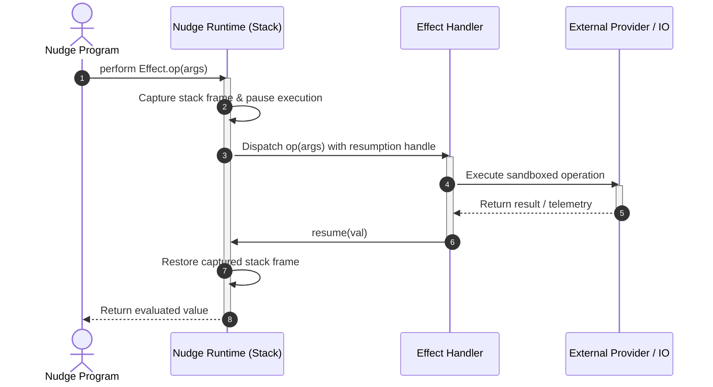

# Algebraic Effect Handlers in Nudge

Nudge uses algebraic effects and handlers to decouple agent intent (e.g. calling an LLM, making an HTTP request, querying memory, or performing OS actions) from runtime execution.

## Resolution Lifecycle

When a program performs an operation declared in an `effect`, execution yields control to the nearest enclosing `handler`. The handler evaluates the operation and optionally resumes the calling computation with a value.

## Semantics

1. **Explicit Effect Declarations**: All side-effecting operations are typed under `effect Name { op(args): ReturnType }`.
2. **Fail-Closed Resolution**: If no enclosing handler covers an executed effect, `nudge-runtime` halts with an unhandled effect diagnostic (`E0301`).
3. **Resumption Mechanism**: Handlers can resume the calling stack once (`resume(val)`), replace it with a fallback, or terminate early upon budget or security constraint violations.
